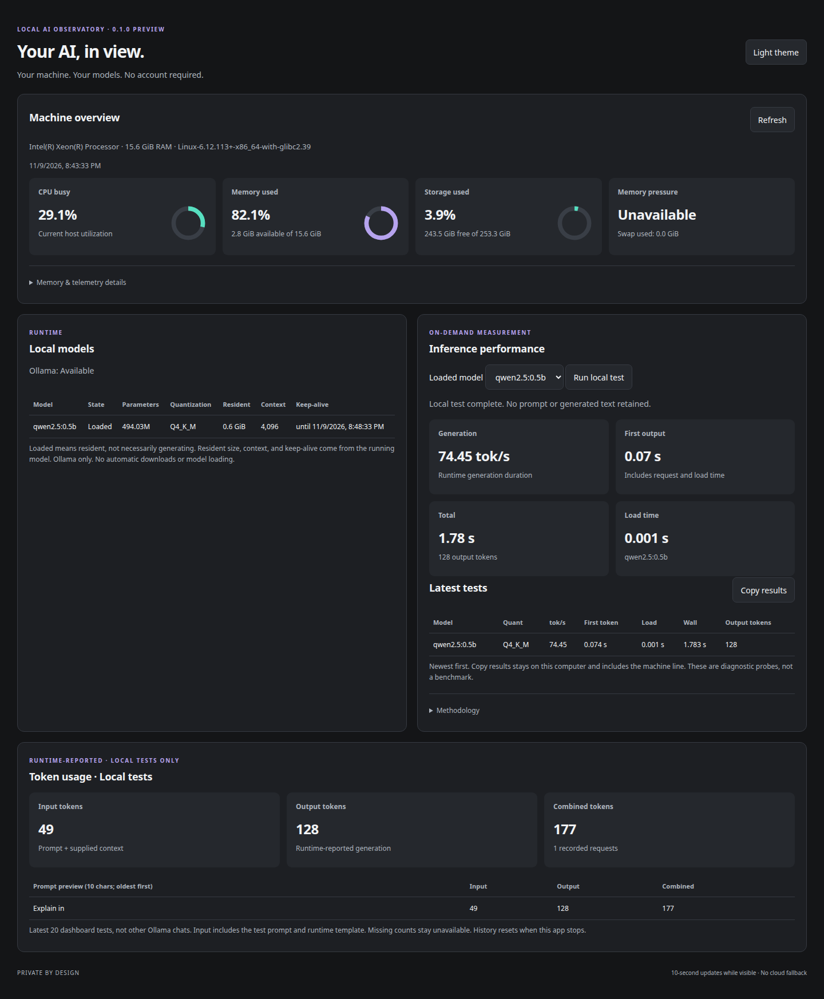
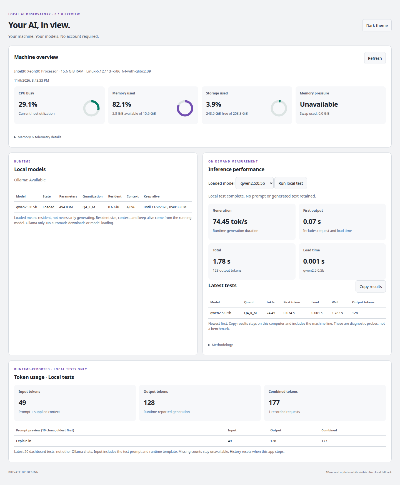

# Local AI Observatory

Version 0.1.0-preview — standalone community evaluation package.

A local-first dashboard for people experimenting with local LLMs. No Hermes installation, SSH server, Tailscale account, or cloud subscription is required.

## Features

- Compact CPU, memory and storage donut charts.
- Apple Silicon unified-memory labeling, macOS memory pressure, swap and compressed memory where available.
- Local Ollama installed and loaded model inventory, including resident size, context length, and keep-alive expiry for loaded models. GPU memory is shown only when a GPU is present. A CPU-only `size_vram` value is not displayed.
- Explicit, user-triggered inference tests: generation tokens/second, first output, elapsed time, runtime load time and output tokens.
- A visible comparison of the latest 20 dashboard tests, with a Copy results button. Input/output token totals cover those tests only.
- Light and dark themes; no external fonts, analytics or images.

## Quick start — macOS or Linux

Requires Python 3.10+ and a browser. The dashboard does not need administrator privileges, an account, or an API key.

Debian and Ubuntu need the distro virtualenv package once before the first launch. The launcher does not install system packages. If `python3 -m venv` cannot create `.venv`, it deletes any half-built folder and prints the package that matches your Python, for example:

```bash
sudo apt install python3.12-venv
```

Install that package, then run the launcher again. Later launches stay in this folder and do not need root. First setup downloads psutil from PyPI into the `.venv`. That download needs a network.

### From git

```bash
git clone https://github.com/edragon12/local-ai-observatory.git
cd local-ai-observatory
bash Start.command
```

### From a ZIP

1. Extract the ZIP into a writable folder.
2. Open Terminal on the computer you want to monitor.
3. Type `bash `, drag `Start.command` into Terminal, then press Return. From that folder, `bash Start.command` does the same thing.
4. Open http://127.0.0.1:8767 in a browser.
5. Keep Terminal open. Press Control-C to stop.

If port 8767 is occupied, stop your older dashboard first. Alternatively, after setup run `.venv/bin/python3 server.py --port 8768` and open the matching address.

### Ollama, then Run local test

Hardware charts work with Ollama absent. To run a probe, install Ollama from https://ollama.com, start it, and load a small model:

```bash
ollama pull qwen2.5:0.5b
ollama run qwen2.5:0.5b
```

`ollama run` is the local chat that loads the model. The Ollama desktop app's chat does the same thing. Leave the model loaded, refresh the dashboard, choose it, and press Run local test. This app does not download or load models.

Tests use a fixed prompt, up to 128 output tokens, a 4K context request and five-minute keep-alive. A test consumes local compute and may change runtime allocation. Tests never run automatically. Results remain in process memory, not on disk; restarting clears them. These are small diagnostic probes, not standardized benchmarks or quality assessments.

## Platform scope

Apple Silicon/macOS: unified-memory, pressure, swap and compressed-memory readings are implemented. This 0.2.0 change was not run on Apple hardware, so those paths are covered by unit tests of the parsers only. macOS metrics may be unavailable on some OS versions.

Linux: basic CPU, RAM, storage and loopback Ollama paths have been exercised. macOS memory-pressure/compression readings remain unavailable. This preview does not collect NVIDIA/AMD GPU utilization.

Not included: Windows validation, MLX, model-fit estimation, remote-host management, Hermes logs, subscription/OAuth quotas, process ownership collector or all-runtime traffic/token monitoring. These can become optional integrations, but no personal account or server configuration ships here.

## Privacy and security

See PRIVACY.md. The server binds to loopback only. Do not change that binding or place the app behind a public proxy without a separate authentication/security design. Basic operation needs no root once Python's venv support is available, and no OAuth or API keys. On Debian/Ubuntu the venv package is a one-time distro install; see Quick start.

## Screenshots

Linux, after a local diagnostic probe:





No macOS screenshot is included. This change was not run on Apple hardware, and a capture from that machine is not in the repository. Do not treat the Linux screenshots above as a macOS result.

## Tests

With the launcher environment initialized:

```
.venv/bin/python3 -m unittest -v
```

Optional JavaScript checks with Node.js: `node --check app.js` and `node test_features.js`.

## Distribution status

This is an unsigned source preview, not a notarized macOS application or DMG. Review and test before wider distribution. Do not disable Gatekeeper; launch using Terminal as above. No updater, startup service or privileged collector is installed.

The original project code is MIT licensed (see LICENSE). Third-party components keep their own licenses (see THIRD_PARTY_NOTICES.md).

## Version 0.2.0

`VERSION` is 0.2.0. Optional features stay off until you configure them. Nothing in this package names a private machine, and copying `observatory.example.json` does not turn anything on.

Where an older paragraph says model-fit, a second host, or GPU readings are absent, this section is the current behavior.

### What you can turn on

- **Generation tok/s sparkline.** The last 30 probe runs for each host stay in this browser (model name and numbers only).
- **Memory fit.** Loaded models are marked FITS, SPILLS, or CPU from Ollama's resident size versus the GPU-mapped share. On unified memory that share is not a separate VRAM pool.
- **Prompt processing versus generation.** Both speeds come from the runtime's own prompt and generation timings.
- **GPU power and temperature.** Shown only when `nvidia-smi` reports them. Missing values are left blank, not shown as zero.
- **This computer versus an optional remote host.** The same fixed probe, with a row that says when the models differ or when no remote host is configured.
- **Post mode.** A header toggle, remembered in this browser, hides host labels, the remote-host note, keep-alive times, the sample clock, and live prompt text. Local versus external counts stay visible.
- **Prompt tokens.** Pick an installed model, paste text, and optionally compare a second model. The dashboard reads `tokenizer.ggml.*` from the GGUF file already on disk. It does not read weights, load the model, or download anything.
- **Live from Open WebUI.** Optional. A filter you install in Open WebUI posts each turn to a local receiver. The panel shows first-token time, tok/s, and the route. If a router sends a leading bold label (the default pattern is a `**label**` line), that label is the route and does not start the first-token clock. Show text is on until you turn it off; Post mode forces it off.
- **Glance strip.** Local calls, external calls, unknown calls, and local share (local ÷ (local + external)) from a log file you choose. JSON lines are built in. A line pattern or a small Python module (`read_glance(path, options)`) can replace that reader.

The page order is: machine overview, Live from Open WebUI (open), models and inference, the comparison row, dashboard-test token totals, then Prompt tokens (open).

There is no subscription or account-quota panel.

### Configure

Copy the example and edit the copy. The server also reads `OBSERVATORY_CONFIG` if you set it. Environment variables override the file: `OBSERVATORY_REMOTE_URL`, `OBSERVATORY_REMOTE_LABEL`, `OBSERVATORY_REMOTE_HOST`, `OBSERVATORY_REMOTE_ORIGIN`, `OBSERVATORY_LIVE_TOKEN_FILE`, `OBSERVATORY_LIVE_HOST`, `OBSERVATORY_LIVE_PORT`, `OBSERVATORY_LIVE_LOCAL_MODEL`, `OBSERVATORY_ROUTE_LABEL_PATTERN`, `OBSERVATORY_LOCAL_LABEL_PREFIX`, `OBSERVATORY_GLANCE_LOG`, `OBSERVATORY_GLANCE_FORMAT`, `OBSERVATORY_GLANCE_MODULE`.

```bash
cp observatory.example.json observatory.json
```

`observatory.json` is gitignored. Do not commit tokens or private host names.

#### Optional remote host

Run this same dashboard on the other computer, bound to loopback. On the computer where you view the page, forward that port yourself, then set a loopback URL:

```bash
ssh -N -L 18766:127.0.0.1:8767 user@remote-host
```

```json
"remote": {
  "enabled": true,
  "label": "Remote host",
  "base_url": "http://127.0.0.1:18766",
  "host_header": "127.0.0.1:8767",
  "origin": "http://127.0.0.1:8767"
}
```

`base_url` has to be `http://127.0.0.1:port` or `http://localhost:port`. Any other host is ignored. The dashboard does not open SSH itself. `host_header` and `origin` matter when the forward's local port is not the port the remote dashboard checks. Hardware and history are read with GET. A remote probe or tokenization runs only when you click the button. Redirects are not followed.

#### Optional Open WebUI live tap

On the machine that should receive events:

```bash
python3 live_tap.py --init
```

That creates `~/.config/local-ai-observatory/live-tap.token` (mode 0600) if it is missing, and prints the token once. Restart the dashboard. The receiver listens on `127.0.0.1:8768` only when that file exists. Set `OBSERVATORY_LIVE_HOST` if Open WebUI runs in a container and must reach the host by another address, and add that network to `allowed_networks` (for example a private container range you confirm on your machine). The default allow list is loopback only.

In Open WebUI: Admin Panel → Functions → new function, paste `openwebui_live_filter.py`, save, enable it, and set it to Global or to one model. Put the token in the token valve. The default endpoint is `http://127.0.0.1:8768/live/events`. From inside a container, loopback is the container, so set the endpoint to the host address you confirmed. Nothing is sent while the token is empty. If the receiver is down, the chat is unchanged.

`local_model` is optional. Set it when local turns should be tokenized as a specific installed model instead of the name Open WebUI reports. `route_label_pattern` is a Python regular expression with one group for the label. The default matches a bold label and a blank line at the start of the reply.

#### Optional glance log

Point `glance.path` at a file. JSON lines look like `glance.example.jsonl`:

```json
{"time":"2026-01-02 03:04:05","model":"example-local","provider":"ollama","route":"local"}
```

`route` may be `local`, `external`, or `unknown`. If it is omitted, `provider` is classified with `local_providers` and `external_providers`. Other providers stay unknown. `format` may be `jsonl`, `pattern` (a regex with named groups `time`, `route`, `provider`), or `module` (a dotted import name that defines `read_glance`). The reader only tails the file. It does not follow a network.

### What was deliberately left out

Personal host names, addresses, account names, home-directory paths, SSH keys, and token files are not in this repository. There is no bundled subscription or plan-quota view. There is no default remote host. The live receiver and the glance log do nothing until you point at them. The dashboard does not load or download models.

### What was tested

Unit tests cover the GGUF metadata reader, prompt versus generation speeds, the NVIDIA text parser, glance counts, remote-host allowlisting (against a local fake server, including "no redirect"), live-tap timing (a label chunk does not start the clock), redaction when text is off, and the browser helpers in `test_features.js` with mock numbers.

Not tested here: Apple hardware, a real GPU, Open WebUI with the filter installed inside it, or a second physical machine. The Linux screenshots in this repository are from the earlier preview, not from this optional UI. No new screenshot was added, because a useful one would need a running browser session and this pass did not produce a mock-only capture worth publishing.
